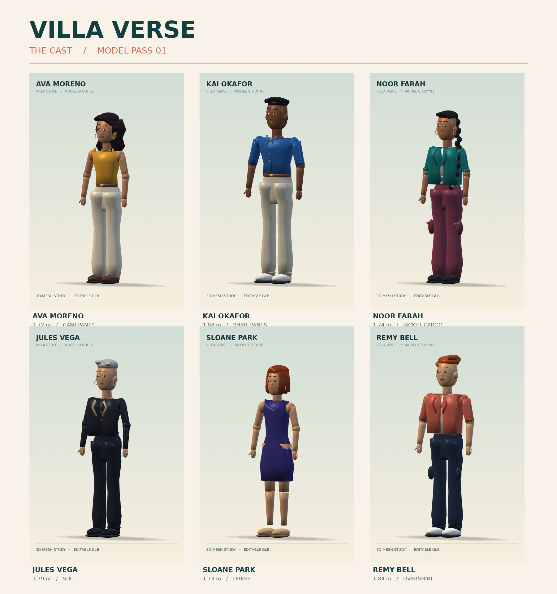

# Ava & Noor — Villa Verse 3D Production



**Restored working project: 2026-11-23.** Source, production notes, storyboard, recoverable assets, the latest v2.1 rigged characters, tests, and agent-experiment infrastructure are preserved here.

> **Quality status: prototype / not creatively approved.** The latest handhold is still unconvincing, facial mouth-corner topology needs improvement, and native Godot playback has not been verified. The Producer–Auditor experiments have **not** demonstrated two independent live AI model sessions.

## Watch and inspect

- [Latest v2.1 MP4 — Ava and Noor](models/v2.1/previews/Ava_Noor_v21_MOUTH_REPAIR_GRIP.mp4)
- [Animated v2.1 GIF](models/v2.1/previews/Ava_Noor_v21_PREVIEW.gif)
- [Six-pose v2.1 visual inspection](models/v2.1/previews/SIX_POSE_V21_INSPECTION.png)
- [Original episode script](storyboard/EPISODE_SCRIPT_AND_SHOTPLAN.md)
- [Original storyboard viewer](storyboard/v1.1/VillaVerse_E01_TheWrongChoice/storyboard_viewer.html)

## Recover the 3D models

The six earlier v1.3 cast models are directly tracked in `models/v1.3/`.

The latest Ava and Noor v2.1 GLB models and 14 original source-model inputs are preserved as **Git-tracked, hash-verified binary chunks** because the upload connector could not upload these larger files in one request.

```bash
git clone https://github.com/hikiro/Ava-Noor-3D-love-.git
cd Ava-Noor-3D-love-
python tools/reassemble_extra_assets.py
python tools/reassemble_glb.py
```

The scripts verify every binary chunk and each complete file against SHA-256 checksums. The final character GLBs are recreated in `models/v2.1/godot/models/` and `models/v2.1/models/`; the PLY, NPZ and base GLB inputs are restored under `models/v2.1/models/`.

For convenience, the [GitHub Actions build](https://github.com/hikiro/Ava-Noor-3D-love-/actions/workflows/assemble-glb.yml) automatically reconstructs and checksum-verifies all these assets and publishes a downloadable ZIP artifact. The artifact has limited retention, but the underlying tracked chunks stay in the repository.

### Running the scene

The Godot project is under `models/v2.1/godot/`. Restore the GLBs first. The included `run_godot_checks.ps1` and `run_godot_checks.sh` scripts are provided for a local Godot installation. Their presence does **not** establish that Godot was successfully run in ChatGPT.

## Directory map

| Path | Contents |
| --- | --- |
| `models/v2.1/` | Most recent model source and scripts, rig files, QC evidence, rendered previews, and binary-part manifests |
| `models/v1.3/` | Original six-character cast GLBs, turnarounds, measured-proportion and lookdev images |
| `storyboard/` | Episode 01 original script, frames, backgrounds, sprites and storyboard renderer |
| `history/` | Rigging directions, lessons, failure logs and version records from v1.2–v2.1 |
| `production-v3/` | Producer-led studio configuration and Claude-compatible specialist role instructions |
| `production/` | Producer workflow, task board and assessments |
| `agents/` | Public QA and two Producer–Auditor experiment implementations; recorded mock/infrastructure results |
| `tools/` | Original-file binary reconstruction and verification scripts |
| `recovery/` | Upload coverage, deliberately excluded private files and archive limitations |

## Rigging and QC rules

Keep the head attached to the body; maintain measured proportions and stable joint pivots; preserve believable foot contact, weight shift and motion direction; prevent exaggerated limb displacement from small torso movements. Test mesh deformation across the sequence, not only in rest poses. Distinguish structural/numerical passes from artistic approval, native-engine execution, or user acceptance.

## Privacy and completeness

This repository is **public**. Do not upload private encryption keys, credentials, sealed internal audit reports or private agent memory stores. Full historical handover ZIPs containing duplicate archived versions are not committed. See [recovery/UPLOAD_STATUS.md](recovery/UPLOAD_STATUS.md) for the exact scope and gaps.

No blanket project license has been declared. Redistribution/provenance should be reviewed before granting broad reuse rights.
