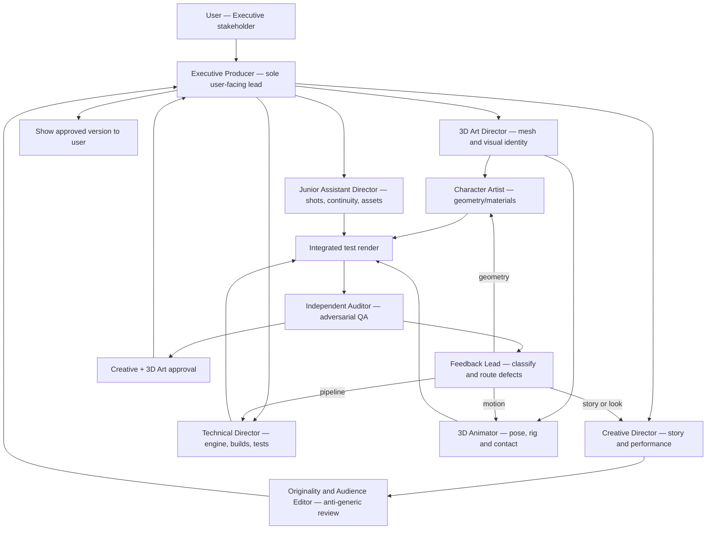

# Villa Verse production hierarchy and efficient execution

## Operating rules

1. Producer converts the user goal into measurable acceptance criteria and locks **one quality target** before implementation. No user intervention is needed for normal defects.
2. Creative director and 3D art director approve concept/anatomy targets; the junior AD independently creates shot timing/asset inventory while technical director checks format/tool feasibility.
3. Artist and animator may work in parallel ONLY after skeleton interfaces and file ownership are stable. The animator owns motion tracks; the artist owns meshes and morphs; technical director owns export scripts. Changes to joint names require an integration contract change.
4. Every candidate generates a full-speed video, close-ups from two oblique angles, front/side turnarounds, numerical rig and collision evidence, and a failure log with exact timestamps.
5. Auditor is read-only, reviews output rather than its creator's description, and may reject even a passing metrics report. Feedback lead writes reproducible, owner-routed issue cards.
6. At most **two local repair attempts** per fundamental symptom before the producer commissions an architectural alternative/proof of concept. Do not turn this into a 20-loop vanity target.
7. Final gate: storyboard/acting, 3D art, originality, rigging/contact, engineering-native-import, independent QA, and producer verdict all PASS. Any genuine BLOCKED gate means no final-production-quality claim.
8. User receives a producer summary with a preview only when final accepted. Technical prototypes may be shared, explicitly labeled, for project handover or if specifically requested.

## Modes
- **Chat-only:** one assistant runs named *review lenses* in sequence and executes real tests; it is not multiple independent AI agents. Use prepared role prompts and machine review cards, but log `execution_mode: chat_single_model`.
- **Claude Code subagents:** the `.claude/agents/*.md` files become executable delegations when loaded in a Claude Code project. Requires running Claude Code with whatever access/usage user has; not directly launched by this chat.
- **Experimental agent teams:** enable only if cooperative peer-to-peer agents really help and the user's usage budget permits; Anthropic notes substantial extra token usage. Not enabled by default.

## Time-saving objective
Stop endless single-triangle or 0.01-radian revisions that cannot close a perceptual problem. Reuse a mature anatomical base, establish a style target, compare a short motion in a fixed shot, and invest only after artistic sign-off.